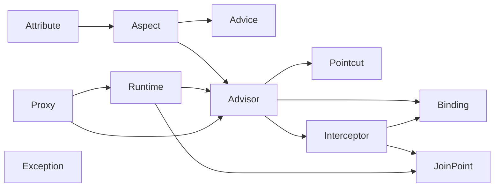

# Architecture

For contributors.
This page describes how the two packages are laid out, which class does what, how to extend the pointcut language or the advice types, and how to run the checks.

## Repository layout

```
symfony-aop/
├── lib/aop/                      phauthentic/aop        Phauthentic\AOP\
│   ├── src/
│   └── tests/                    Phauthentic\AOP\Tests\ (Unit/, Fixtures/)
├── lib/aop-bundle/               phauthentic/aop-bundle Phauthentic\AOP\Symfony\
│   ├── src/
│   └── tests/                    Phauthentic\AOP\Symfony\Tests\ (Integration/, Fixtures/)
├── src/                          demo application, App\
├── tests/E2E/                    end-to-end tests against the demo kernel
├── config/                       demo Symfony config (bundles.php, packages/phauthentic_aop.yaml)
└── docs/
```

The root `composer.json` installs both packages as symlinked path repositories, so edits in `lib/` are live.
`phauthentic/aop` depends only on PHP 8.2 and `nette/php-generator`.
`phauthentic/aop-bundle` adds `symfony/config`, `symfony/dependency-injection`, `symfony/http-kernel` and `symfony/console` at `^7.2`.

## Core package: `Phauthentic\AOP\`

Diagram: dependencies between the core namespaces (arrow means "uses").



| Namespace | Classes | Responsibility |
|---|---|---|
| `Attribute` | `Aspect`, `Order`, `Pointcut`, `Before`, `After`, `Around`, `AfterReturning`, `AfterThrowing`, `Proxyable` | The user-facing attributes. Data only. |
| `Advice` | `AdviceType` (enum with `precedence()` and `attributeClass()`), `AdviceDefinition` | One advice method as data: aspect class, method, type, expression, `returning`/`throwing`, declaration index. |
| `Aspect` | `AspectMetadataReader`, `AspectMetadata`, `AspectInstanceResolverInterface`, `ArrayAspectInstanceResolver` | Reflection of an aspect class into metadata; supply of aspect instances at runtime. |
| `Pointcut\Expression` | `Lexer`, `Token`, `TokenType`, `Parser`, `Ast\*`, `PointcutExpressionCompiler`, `NamedPointcutResolverInterface` | Text to AST to `PointcutInterface` tree. The compiler also turns bare identifiers into `BindingSpec`s. |
| `Pointcut\Pattern` | `TypePattern`, `NamePattern`, `ParameterPattern`, `ModifierPattern`, `ArgumentMatcher` | Reusable matchers for names, types, parameter lists and runtime argument values. |
| `Pointcut` | `PointcutInterface`, one class per designator, `AndPointcut`, `OrPointcut`, `NotPointcut`, `TruePointcut`, `StaticMatchContext`, `RuntimeMatchContext`, `RuntimeEvaluation`, `BindingSpec`, `BindingKind`, traits `SubjectBinding` and `ArgumentList` | The matching logic, split into static and runtime halves. |
| `Advisor` | `Advisor`, `AdvisorFactory`, `AdvisorRegistry`, `AdvisorOrderComparator`, `AdvisorChainFactory`, `MetadataNamedPointcutResolver` | Metadata to advisors, sorting, and building the interceptor list for one method. |
| `Binding` | `ParameterBinder`, `BindingPlan`, `BoundArguments` | Decide once per advice where each parameter comes from; produce the argument list per call. |
| `Interceptor` | `MethodInterceptorInterface`, `AdviceInvoker`, `BeforeAdviceInterceptor`, `AfterAdviceInterceptor`, `AfterReturningAdviceInterceptor`, `AfterThrowingAdviceInterceptor`, `AroundAdviceInterceptor`, `RuntimeGuardInterceptor` | One link of the chain per advisor. `RuntimeGuardInterceptor` wraps an interceptor whose pointcut needs per-call evaluation. |
| `JoinPoint` | `JoinPointInterface`, `ProceedingJoinPointInterface`, `MethodInvocation`, `MethodSignature` | What advice sees. `MethodInvocation` is the chain walker. |
| `Runtime` | `AopRuntime` | Entry point for proxies; caches chains per proxy class and method; maps proxy classes to bean names. |
| `Proxy` | `ProxyStrategy`, `ProxyStrategyResolver`, `MethodEligibility`, `ProxyGeneratorInterface`, `SubclassProxyGenerator`, `InterfaceProxyGenerator`, `ProxyCodeBuilder`, `ProxyClassName`, `GeneratedProxy`, `ProxyClassWriter`, `AdvisedInterface`, `ProxyFactory` | Decide whether and how to proxy, generate code, write and load it. `ProxyFactory` is the framework-free front door. |
| `Exception` | `AopException` (abstract), `AspectDefinitionException`, `PointcutSyntaxException`, `UnsupportedPointcutDesignatorException`, `BindingException`, `ProxyGenerationException` | All extend `\RuntimeException`. |
| | `Version` | `Version::VERSION`, currently `0.1.0-dev`. |

### PointcutInterface

```php
interface PointcutInterface
{
    public function matchesClass(\ReflectionClass $class, StaticMatchContext $ctx): bool;
    public function matchesMethod(\ReflectionMethod $method, StaticMatchContext $ctx): bool;
    public function isRuntime(): bool;
    public function matchesRuntime(RuntimeMatchContext $ctx): bool;
    /** @return array<string, BindingSpec> */
    public function bindings(): array;
}
```

Contract:

- `matchesClass()` is a cheap pre-filter; `matchesMethod()` is the full static decision and receives the target class through `$ctx->targetClass`.
- `isRuntime()` is `true` only when `matchesRuntime()` has something to decide or bind.
  `AdvisorChainFactory` wraps such advisors in `RuntimeGuardInterceptor`; the others go straight into the chain.
- `matchesRuntime()` must call `$ctx->bind($name, $value)` for every `BindingSpec` it reports from `bindings()`, and only after it has decided that the call matches.
- `StaticMatchContext` carries the target class, the bean name and the strategy; `RuntimeMatchContext` carries proxy, target, method, args and the static context.
- Combinators: `AndPointcut` short-circuits and only re-evaluates runtime children; `OrPointcut` re-evaluates both halves fully via `RuntimeEvaluation::matches()` because a branch whose static half failed must not win at runtime; `NotPointcut` refuses bindings and defers to runtime when its child is runtime.

### Weave-time versus runtime

The same `AdvisorRegistry` and `AdvisorChainFactory` are used in both phases.
At weave time `matchedAdvisors()` decides which methods get overridden.
At runtime `chain()` builds the interceptors for a method on first call.
Both see the same `StaticMatchContext` shape (class, bean name, strategy), so a method advised at weave time always gets the same advisors at runtime.
`AopRuntime::build()` derives the strategy from `$proxy instanceof $class`, which is exactly the subclass/interface distinction.

### Chain walking

`MethodInvocation::proceed()` clones itself with `index + 1` and hands the clone to the next interceptor.
Because each interceptor holds its own positioned copy, an `#[Around]` may call `proceed()` repeatedly and each call restarts the remainder of the chain from the same point.
`withBoundArguments()` also clones, so bound values from a `RuntimeGuardInterceptor` are visible only to the interceptor it guards.

## Bundle package: `Phauthentic\AOP\Symfony\`

| Class | Responsibility |
|---|---|
| `PhauthenticAopBundle` | Registers `#[Aspect]` autoconfiguration (tag `phauthentic_aop.aspect`), adds both passes at `TYPE_BEFORE_REMOVING`, registers the proxy autoloader in `boot()`. |
| `DependencyInjection\Configuration` | The `phauthentic_aop` config tree and defaults. |
| `DependencyInjection\PhauthenticAopExtension` | Loads `Resources/config/services.php` and sets the four parameters, unless `enabled: false`. |
| `Compiler\AspectCollectorPass` | Collects aspects, validates, wires registry argument and aspect locator. |
| `Compiler\ProxyWeavingPass` | Matches, generates, writes, rewires definitions, produces the weaving report. |
| `Container\AdvisorRegistryFactory` | `create(array $aspectClasses): AdvisorRegistry`, used at compile time and as the runtime service factory. Wraps failures in `AspectDefinitionException` naming aspect and method. |
| `Container\ContainerAspectInstanceResolver` | `AspectInstanceResolverInterface` over a service locator. |
| `ProxyAutoloader` | `spl_autoload_register` for `Phauthentic\AOP\Generated\*` across every registered proxy directory; produces the contents of `autoload.php`. |
| `Command\DebugAopCommand` | Renders the weaving report. |

See [Symfony bundle](symfony.md#how-weaving-works) for the pass algorithm step by step.

## Adding a pointcut designator

Say you want `returns(TypePattern)` matching on the declared return type.

1. `Pointcut\Expression\Lexer`: add `'returns'` to `DESIGNATORS` so it is lexed as a keyword when followed by `(`.
2. `Pointcut\Expression\Ast`: add `ReturnsNode` implementing `NodeInterface` with the parsed data (a `TypePatternNode`).
3. `Pointcut\Expression\Parser::parseDesignator()`: add a `'returns' => new ReturnsNode($this->typePattern($this->expectWord(), $this->accept(TokenType::Question) !== null, $this->acceptPlus()))` arm.
   Reuse `typePattern()`, `typeOrBinding()` or `paramList()` depending on the argument shape.
4. `Pointcut\ReturnsPointcut`: implement `PointcutInterface`.
   A purely static designator returns `false` from `isRuntime()`, `true` from `matchesRuntime()` and `[]` from `bindings()`.
   A designator that binds should use the `SubjectBinding` trait (single subject) or the `ArgumentList` trait (positional list) and call `$ctx->bind()` in `matchesRuntime()`.
5. `Pointcut\Expression\PointcutExpressionCompiler::build()`: add the `$node instanceof ReturnsNode => new ReturnsPointcut(TypePattern::fromNode($node->type))` arm.
6. Tests: add cases to `tests/Unit/Pointcut/Expression/ParserTest.php` (AST shape and error positions), `PointcutExpressionCompilerTest.php` (compiles to the right class) and a new `tests/Unit/Pointcut/ReturnsPointcutTest.php` for matching against the `Fixtures/Hierarchy` classes.
7. Document it in [Pointcut expressions](pointcuts.md).

If the designator should remain unsupported but be recognised, add its name to `Parser::UNSUPPORTED` so it raises `UnsupportedPointcutDesignatorException` instead of a generic syntax error.

## Adding an advice type

The advice types are closed over an enum, so a new one touches several places.

1. `Attribute\<Name>`: a `#[\Attribute(\Attribute::TARGET_METHOD)]` class with a `string $pointcut` constructor property, plus extra options if needed.
2. `Advice\AdviceType`: add the case, give it a slot in `precedence()` and map it in `attributeClass()`.
3. `Aspect\AspectMetadataReader::read()`: the loop over `AdviceType::cases()` picks the attribute up automatically; extend the `AdviceDefinition` construction if the attribute carries extra data (as `AfterReturning` does with `returning`).
4. `Interceptor\<Name>AdviceInterceptor`: implement `MethodInterceptorInterface`, hold an `AdviceInvoker`, and decide when to call `$this->advice->call($invocation, $returnValue, $thrown)` relative to `$invocation->proceed()`.
5. `Advisor\AdvisorChainFactory::interceptor()`: add the `match` arm.
6. `Binding\ParameterBinder::plan()`: add validation if the type has rules (`Around` requires a proceeding join point; others forbid it).
7. Tests: `tests/Unit/Interceptor/<Name>AdviceInterceptorTest.php`, extend `AdviceTypeTest`, `AspectMetadataReaderTest`, `ParameterBinderTest` and the ordering assertions in `tests/Unit/Runtime/AopRuntimeTest.php`.
8. Document it in [Advice](advice.md).

## Proxy generation

`ProxyGeneratorInterface::generate(\ReflectionClass $target, array $advisedMethods, string $salt = ''): GeneratedProxy` is the seam.
Both generators delegate signature copying, argument forwarding, return statements and printing to `ProxyCodeBuilder`, so a change to how signatures are reproduced belongs there.
`ProxyClassName::for()` computes the class name; keep the salt semantics (bean name / service id plus directory) when adding inputs, since the name is what makes two services of one class distinct at runtime.

`ProxyClassWriter::load()` is the only place that declares a proxy class: it writes and `require`s when given a directory, `eval()`s otherwise, and never redeclares an already loaded class.

## Testing

```bash
composer check     # cs (php-cs-fixer --dry-run), stan (phpstan level max), test (phpunit)
composer test      # phpunit only
composer stan
composer cs        # report only
composer cs-fix    # apply
```

Test suites in `phpunit.dist.xml`:

| Suite | Directory | What it covers |
|---|---|---|
| `core-unit` | `lib/aop/tests` | Every core class in isolation: lexer, parser, compiler, each designator, patterns, binder, interceptors, runtime ordering, generators, `ProxyFactory`. Fixtures under `Fixtures/` (aspects, target classes, a class hierarchy for type pattern tests). |
| `bundle-integration` | `lib/aop-bundle/tests` | Compiler passes against a real `ContainerBuilder`, configuration, `debug:aop`, and a `TestKernel` that boots from a temporary cache directory, including a separate-process boot through `Fixtures/boot.php` to prove the dumped container loads proxies without rebuilding. |
| `app-e2e` | `tests` | The demo kernel: exact `app:aop-demo` output, `debug:aop` content, and that proxies land only in `var/cache/test/phauthentic_aop`. |

Run one suite with `vendor/bin/phpunit --testsuite core-unit`.

PHPStan runs at level max over `lib/*/src`, `lib/*/tests`, `src` and `tests`.
Tests use PHPUnit 12 attributes (`#[Test]`, `#[CoversClass]`, `#[DataProvider]`).

When changing anything that affects what gets advised, update the expected output in `tests/E2E/AopDemoCommandTest.php` and the real-output blocks in [Symfony bundle](symfony.md#debugaop), [Proxies](proxies.md#generated-code) and [Examples](examples.md#running-it).
