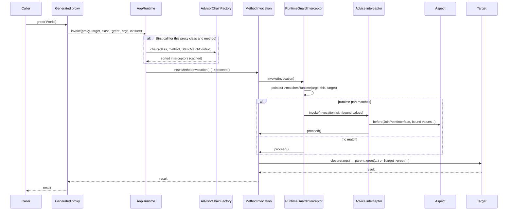
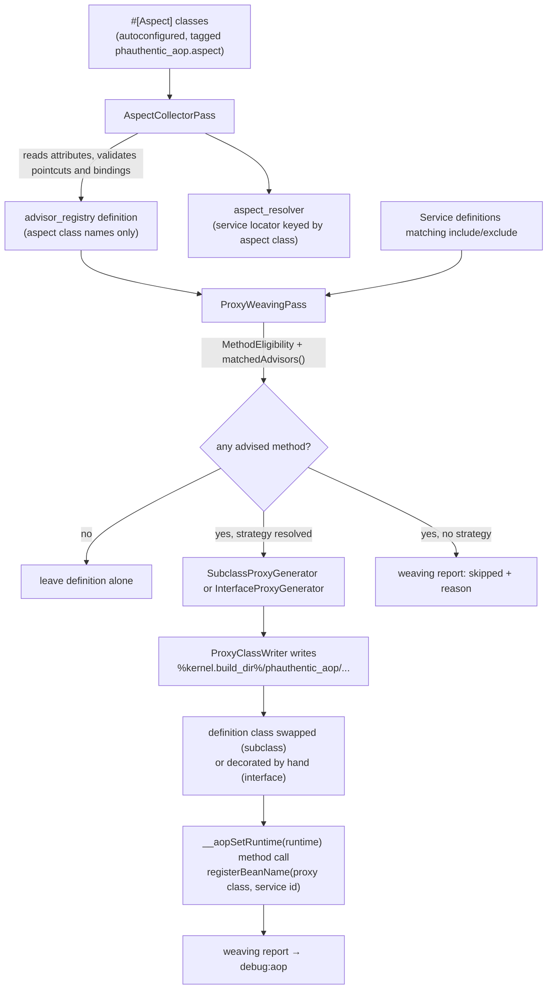

# Concepts

This page maps the AOP vocabulary, as Spring AOP uses it, onto the classes in `phauthentic/aop`.
If you know Spring AOP, the terms mean the same thing here.
If you do not, read the glossary first and then the two flows.

## Why AOP

Some behaviour belongs to many methods at once: logging, validation, retries, caching, transactions, metrics.
Writing it inline scatters the same few lines over the whole service layer.
AOP moves that behaviour into one class, the aspect, and a small expression language decides which methods it applies to.
The service classes stay unaware of it.

## Glossary

| Term | Meaning in this library | Where it lives |
|---|---|---|
| Join point | A point in execution where advice can run. Here: the execution of one public or protected instance method on one object. Nothing else (field access, constructors, static calls) is a join point. | `JoinPoint\JoinPointInterface`, `JoinPoint\MethodInvocation` |
| Pointcut | A predicate that selects join points. Written as an expression string such as `execution(* App\Service\**::*(..))`, compiled into a tree of `PointcutInterface` objects. | `Pointcut\*`, `Pointcut\Expression\*` |
| Advice | The code that runs at a join point. A public method on an aspect, marked `#[Before]`, `#[AfterReturning]`, `#[AfterThrowing]`, `#[After]` or `#[Around]`. | `Attribute\*`, `Advice\AdviceDefinition`, `Advice\AdviceType` |
| Aspect | A class marked `#[Aspect]` that groups advice methods and named pointcuts. Optionally carries `#[Order(int)]`. | `Attribute\Aspect`, `Aspect\AspectMetadata`, `Aspect\AspectMetadataReader` |
| Advisor | One advice plus its compiled pointcut plus its order. The unit the runtime matches and sorts. Its id is `AspectClass::method`. | `Advisor\Advisor`, `Advisor\AdvisorRegistry` |
| Interceptor | The runtime wrapper for one advisor on one method. Each advice type has its own interceptor class. | `Interceptor\*` |
| Proxy | A generated class that stands in for the target and routes advised methods through the runtime. Two strategies: subclass (like CGLIB) and interface (like a JDK dynamic proxy). | `Proxy\*` |
| Target | The object whose method is advised. With a subclass proxy the proxy is the target. With an interface proxy the proxy wraps a separate target instance. | `JoinPointInterface::getTarget()` |
| Weaving | Deciding, per class and method, which advisors apply, then generating and installing the proxy. Happens at container build time in Symfony or on first use with `ProxyFactory`. | `Symfony\Compiler\ProxyWeavingPass`, `Proxy\ProxyFactory` |
| Runtime | The object proxies call into. Builds and caches the interceptor chain per proxy class and method. | `Runtime\AopRuntime` |
| Binding | Passing a value selected by the pointcut (an argument, the target, an attribute instance) into a named advice parameter. | `Binding\ParameterBinder`, `Binding\BindingPlan` |

## Spring AOP to this library

| Spring | Here | Note |
|---|---|---|
| `@Aspect` | `#[Aspect]` | On the class. |
| `@Order` | `#[Order(int)]` | On the class. Lower runs outermost. Default `PHP_INT_MAX`. |
| `@Pointcut` | `#[Pointcut('...')]` on a public, parameterless, `void` method | Referenced as `name()` from the same aspect or `Fully\Qualified\Class::name()` from anywhere. |
| `@Before`, `@After`, `@Around` | `#[Before]`, `#[After]`, `#[Around]` | Same semantics. |
| `@AfterReturning(returning = "r")` | `#[AfterReturning('...', returning: 'r')]` | The parameter type filters which results trigger the advice. |
| `@AfterThrowing(throwing = "e")` | `#[AfterThrowing('...', throwing: 'e')]` | The parameter type filters which exceptions trigger the advice. |
| `JoinPoint`, `ProceedingJoinPoint` | `JoinPointInterface`, `ProceedingJoinPointInterface` | Injected by parameter type, any position. |
| `execution(* com.x..*.*(..))` | `execution(* Com\X\**::*(..))` | `\` separates namespaces, `::` separates type and method, `**` matches any number of segments. |
| `within`, `this`, `target`, `args`, `bean` | Same names | `bean()` matches the Symfony service id or the name you pass to `ProxyFactory`. |
| `@annotation`, `@within`, `@target`, `@args` | Same names | Match PHP attributes instead of Java annotations. |
| `argNames` | Not needed | PHP reflection knows parameter names. |
| JDK dynamic proxy | Interface proxy | For final classes that implement an interface. |
| CGLIB proxy | Subclass proxy | For non-final classes. Self-invocation is advised. |
| `AopContext.currentProxy()` | `AopContext::currentProxy()` | Always available, no `exposeProxy` switch. Use it for self-invocation in interface-proxied targets. See [Proxies](proxies.md#self-invocation-and-aopcontext). |
| `@DeclareParents`, introductions | `#[DeclareParents(typePattern, interface, defaultImpl)]` on the aspect class | The interface is an argument instead of a field type. See [Introductions](introductions.md). |
| `perthis`, `pertarget` | `#[Aspect(scope: AspectScope::PER_THIS)]`, `#[Aspect(scope: AspectScope::PER_TARGET)]` | Aspects are singletons by default. See [Advice](advice.md#aspect-instances). |
| `call`, `cflow`, `get`, `set`, `withincode`, `if` | Not supported | Raise `UnsupportedPointcutDesignatorException`. |

## Flow 1: a call through a proxy at runtime

Diagram: invocation of an advised method.

What the diagram shows, in words:

1. The generated proxy overrides (subclass strategy) or implements (interface strategy) each advised method.
   The override forwards every argument, the class name, the method name and a closure that calls the original implementation to `AopRuntime::invoke()`.
2. On the first call for a given proxy class and method, the runtime asks `AdvisorChainFactory` for the interceptors.
   The factory filters `AdvisorRegistry::all()` with `matchesClass()` and `matchesMethod()`, wraps every advisor whose pointcut has a runtime part in a `RuntimeGuardInterceptor`, and the runtime caches the list.
3. `MethodInvocation` walks the list.
   Each `proceed()` clones the invocation one step further along the chain, so an `#[Around]` advice may call `proceed()` zero, one or several times.
4. When the list is exhausted, the closure runs the original method body.
5. Results and exceptions travel back out through the same interceptors.

The registry is sorted once, so the chain order is the advisor order described in [Advice](advice.md#ordering).

## Flow 2: compile-time weaving in Symfony

Diagram: container build with `phauthentic/aop-bundle`.

Two compiler passes do the work, both registered at `PassConfig::TYPE_BEFORE_REMOVING` so autowiring and decoration have already run.

1. `AspectCollectorPass` collects tagged aspect services, calls `AdvisorRegistryFactory::create()` once to fail the build early on invalid expressions or bindings, and stores only the aspect class names in the registry definition.
   The registry is rebuilt from those names at runtime, so no compiled pointcut is ever serialised into the container.
2. `ProxyWeavingPass` walks every non-abstract, non-synthetic definition whose class matches `include` and not `exclude`, statically matches each eligible method against all advisors, generates a proxy for every class with at least one hit, writes it into the proxy directory and rewires the definition.
   Everything it did or skipped ends up in the `phauthentic_aop.weaving_report` parameter, which `debug:aop` prints.

Details and edge cases are in [Symfony bundle](symfony.md#how-weaving-works).

## Static versus runtime matching

A pointcut has two halves.

- The static half (`matchesClass()`, `matchesMethod()`) is evaluated once per class and method, at weave time.
  `execution`, `within`, `bean`, `@target`, and `this`/`target`/`@annotation`/`@within` without a binding are fully static.
- The runtime half (`matchesRuntime()`) is evaluated on every call, only for advisors whose pointcut reports `isRuntime()`.
  `args` with at least one constraint, `@args`, and any designator that binds a value have a runtime half.

A static mismatch means the advisor is not in the chain at all.
A runtime mismatch means the advisor is in the chain but `RuntimeGuardInterceptor` skips it for that call.
`debug:aop` lists an advisor as soon as its static half matches, so an `args(...)` advice can appear there and still not run for a particular argument.
